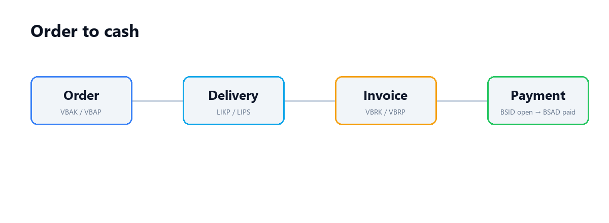
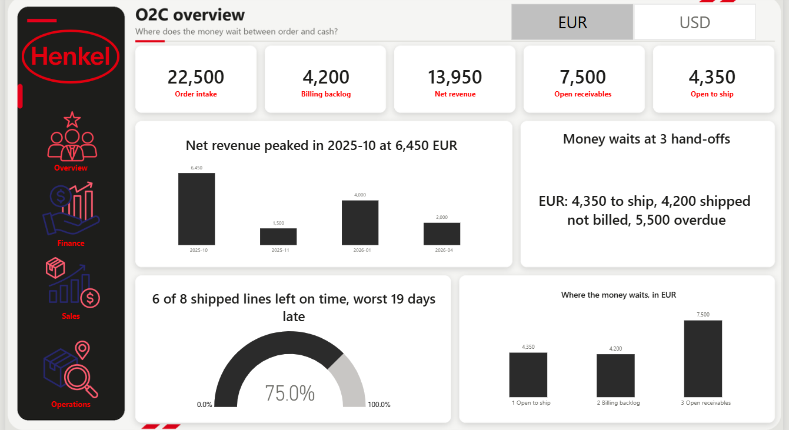
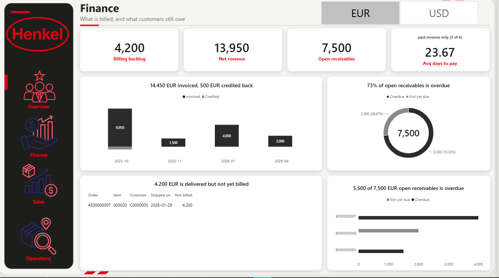
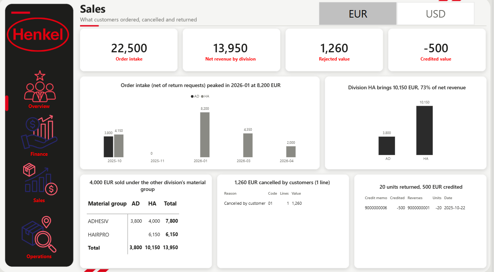
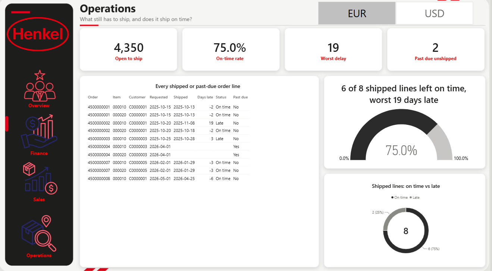
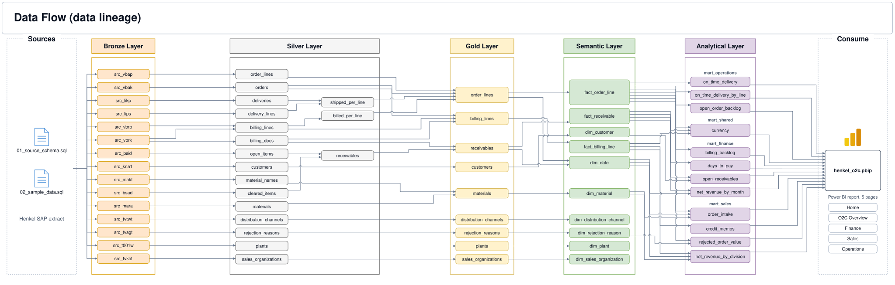
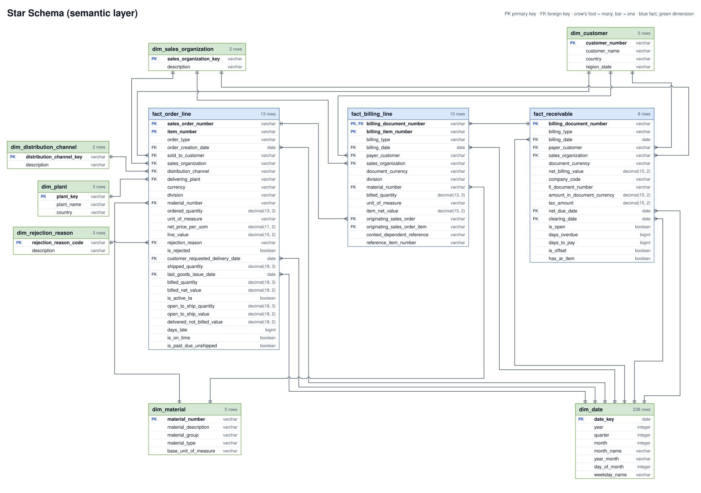

<p align="center">
  
</p>

<p align="center">
  
  
  
  
</p>

<p align="center">
  
</p>


## 📈 Result

| What (EUR, as of 2026-05-04) | Number |
|---|---|
| Net revenue | 13,950 (and 6,000 USD) |
| Ordered, not shipped | 4,350 |
| Shipped, not billed | 4,200 |
| Billed, not paid | 7,500, of which 5,500 overdue |
| Shipped on time | 6 of 8 lines |
| Days to pay | 23.67 |
| Data checks | 43, all passing |

| Overview | Finance |
|---|---|
|  |  |
| **Sales** | **Operations** |
|  |  |

Slides: [pptx](06_reporting/presentation/Henkel_O2C_presentation.pptx) · [pdf](06_reporting/presentation/Henkel_O2C_presentation.pdf)

## 🏗️ Data flow





## ▶️ Run

```
python setup.py
python run_sql.py
```

Power BI: open `06_reporting/henkel_o2c.pbip`, set the `DuckDbPath` parameter to your `data.duckdb`, refresh.

Details: [`docs/technical.md`](docs/technical.md) · exploration: [`01_exploration.ipynb`](01_exploration.ipynb) · brief: [`case_study.md`](case_study.md)

<p align="center">
  
</p>
