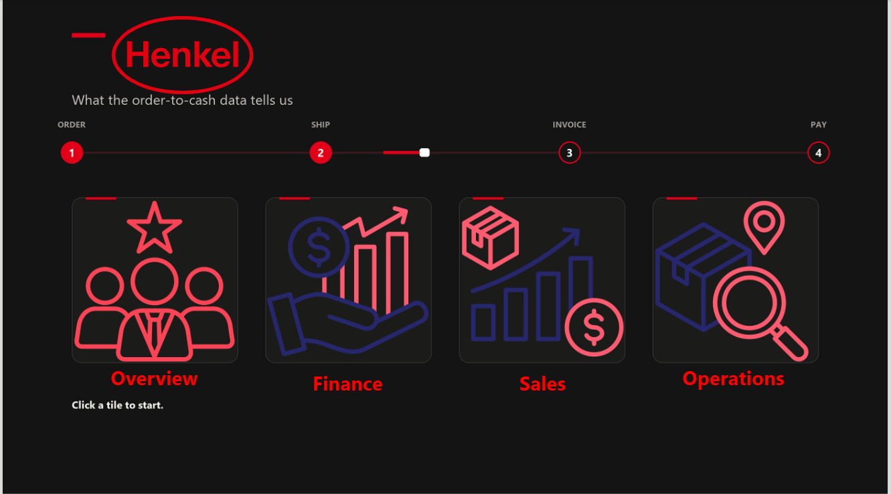
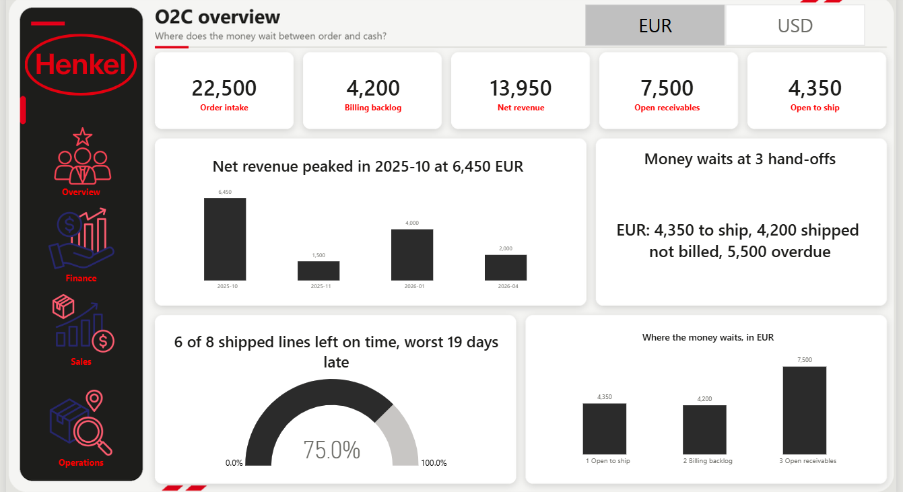
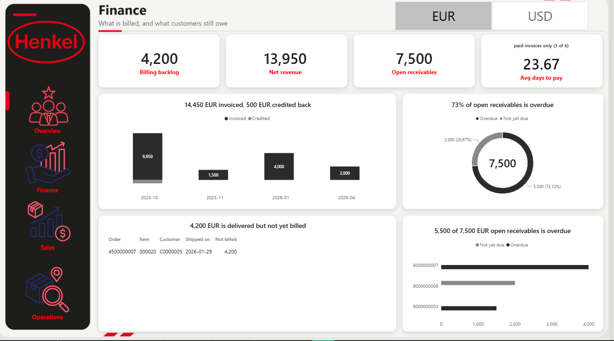
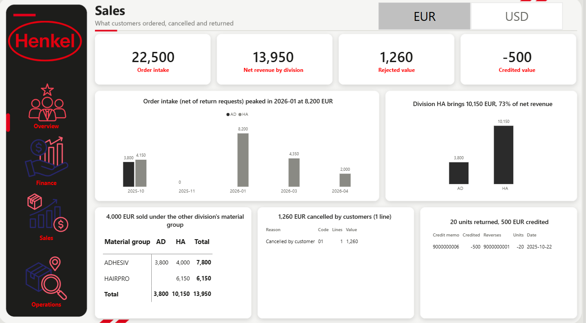
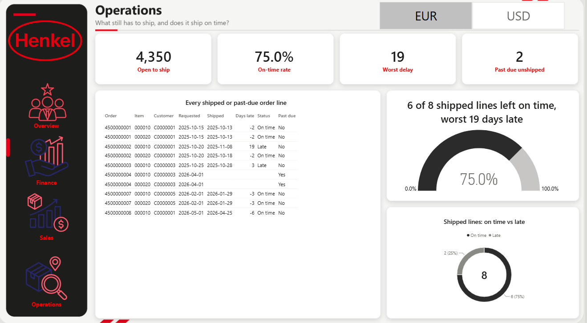

# Technical notes

The engineering detail behind the [README](../README.md): every layer, table, key, rule and check.

## Analytics layer

Plain SQL on DuckDB, in 5 layers: bronze (Henkel's raw tables) -> silver (cleaned tables, keys enforced) -> gold (business rules) -> semantic (star schema with PRIMARY / FOREIGN KEYS and a calendar) -> analytical (one data mart per department: Sales, Operations, Finance). Each layer's build reads only the layer just below it (some quality checks also compare with silver or the raw `src_*` tables). Power BI is the reporting layer and reads only the data marts. The two given SQL files and the `src_*` tables are never changed.

## How the run works

Close any tool holding `data.duckdb` first (notebook kernel, DuckDB UI, DBeaver): DuckDB allows one writer.

`run_sql.py` runs the SQL files in order and prints each one. A check file holds queries that list bad rows: if any query returns a row, the script prints `CHECK FAILED` with the query and the rows and stops. A SQL error or a missing file also stops it, with `ERROR in <file> : <reason>`. Fix the cause and run `python setup.py` and `python run_sql.py` again (every file rebuilds its tables, so a rerun starts clean).

## Folder structure

```
01_bronze/01_source_schema.sql                 Henkel's schema: the 15 src_* tables (unchanged)
01_bronze/02_sample_data.sql                   Henkel's data: 89 rows (unchanged)
02_silver/01_ddl_silver.sql                    silver tables with PRIMARY KEY / FOREIGN KEY (Henkel's keys)
02_silver/02_load_silver.sql                   bronze -> silver: rename, select distinct, sums per order line
02_silver/03_quality_checks_silver.sql         Henkel's rules a constraint cannot express
03_gold/01_ddl_gold.sql                        silver -> gold tables: the business rules
03_gold/02_quality_checks_gold.sql             one row per key; money matches the raw tables
04_semantic/01_ddl_semantic.sql                star schema tables with PRIMARY KEY / FOREIGN KEY
04_semantic/02_load_semantic.sql               gold -> semantic; dim_date from the first to the last fact date
04_semantic/03_quality_checks_semantic.sql     calendar has no gaps and covers today; no rows lost
05_analytical/01_ddl_mart_sales.sql            data mart for Sales (KPI views)
05_analytical/02_ddl_mart_operations.sql       data mart for Operations (KPI views)
05_analytical/03_ddl_mart_finance.sql          data mart for Finance (KPI views)
05_analytical/05_ddl_mart_shared.sql           shared list for every department: currency (runs before the mart checks)
05_analytical/04_quality_checks_marts.sql      KPIs cross-checked across marts
setup.py                                       loads bronze into data.duckdb (Henkel's script; only its folder path changed to 01_bronze/)
run_sql.py                                     runs every step above in order, stops on a failed check
06_reporting/henkel_o2c.pbip                   Power BI project on the data marts (report + model as text files; needs the DuckDB ODBC driver)
06_reporting/screenshots/                      the 5 report pages as images, for reviewers without Power BI
```

## The layers

| Layer | Where | Reads | Type | What it holds | Responsibility |
|---|---|---|---|---|---|
| Bronze | `01_bronze/`, schema `main` | the 2 given SQL files | tables | 15 `src_*` tables | Raw SAP extract, exactly as given (schema line 2: "Bronze / Raw Layer"). |
| Silver | `02_silver/`, schema `silver` | bronze | tables | 18: one per source table (15) + `shipped_per_line`, `billed_per_line` (sums per order line before any join) + `receivables` (open and cleared in one list) | Clean and conform: schema-comment names, `select distinct`, signs; Henkel's keys enforced by PRIMARY KEY / FOREIGN KEY. |
| Gold | `03_gold/`, schema `gold` | silver | tables | 9: `order_lines`, `receivables`, `billing_lines`, `customers`, `materials`, `sales_organizations`, `distribution_channels`, `plants`, `rejection_reasons` | Business rules: open to ship, delivered not billed, days late, on time, past due, days overdue, days to pay, offset. |
| Semantic | `04_semantic/`, schema `semantic` | gold | tables | 10: 7 dimensions + 3 facts (see Data model) | Data modeling: the star schema; every PK and FK declared, so the links are part of the SQL. |
| Analytical | `05_analytical/`, schemas `mart_sales`, `mart_operations`, `mart_finance`, `mart_shared` | semantic | views | 11 KPI views, one data mart per department, + 1 shared currency list | What Finance, Sales and Operations read directly (brief lines 35, 115). All marts share the same star schema, so "revenue" or "customer" means the same thing everywhere. |
| Reporting (Task 3) | Power BI | the data marts | - | one page per department | Display measures only: sums of mart columns, the on-time ratio from the mart counts, a weighted average for days to pay, the peak month and top division for chart titles. One mapping lives in DAX: the Sales mismatch title counts division HA with material group ADHESIV and AD with HAIRPRO (moving it into `mart_sales` is a next step). |

Tables where keys are enforced or rows are handed to the next layer (silver, gold, semantic); views for the KPIs (always current, nothing stored).

## Naming conventions

- snake_case, English names.
- Silver and gold column names copied from a source field use the exact words of that field's comment in `01_source_schema.sql`, in snake_case: `vbeln` "Sales order number" -> `sales_order_number`; `posnr` "Item number" -> `item_number`; `kunnr` "Sold-to customer" -> `sold_to_customer`; `vdatu` "Customer-requested delivery date" -> `customer_requested_delivery_date`. Every rename stays visible in `02_silver/02_load_silver.sql` as `sap_field as new_name`.
- Exceptions, all noted in the silver files: lips/vbrp `meins` ("UOM") is written `unit_of_measure`, as on vbap; bsad `faedt` ("Original due date") is named `net_due_date` like bsid, because it is the same field and both lists are combined. One mart alias says what the field means in its view: `credit_memos.reversed_invoice` = `context_dependent_reference` (vgbel), which on a credit memo is always the original invoice. Two long comments are shortened: lips `lfimg` "Delivered quantity for THIS delivery item" -> `delivered_quantity`; vbrp `vgpos` "Reference item number within the vgbel document" -> `reference_item_number`.
- Added columns (not in the source) say what they compute: `line_value`, `is_rejected`, `shipped_quantity`, `open_to_ship_value`, `days_late`, `is_on_time` ...
- Flags start with `is_` / `has_` (`is_open`, `has_ar_item`).

## Source data model (bronze, the 15 `src_*` tables)

PK and FK as documented in `01_source_schema.sql` (header lines 19-71 and the column comments), with two exceptions: `makt` is loaded in English only, so its silver key is `matnr` alone (a check makes sure every material has an English text); `vbrp.vgbel` has no FK because its target depends on the billing type (a check tests it). In bronze nothing enforces them (schema line 9: "logical only"); `02_silver/01_ddl_silver.sql` declares every one of them as a real PRIMARY KEY / FOREIGN KEY on the silver tables, so DuckDB refuses a duplicate key, a NULL key or a link to a missing row.

| Table | What it holds | PK | FK |
|---|---|---|---|
| `src_tvkot` | sales organizations | `vkorg` | - |
| `src_tvtwt` | distribution channels | `vtweg` | - |
| `src_t001w` | plants | `werks` | - |
| `src_kna1` | customers | `kunnr` | - |
| `src_mara` | materials | `matnr` | - |
| `src_makt` | material names | `matnr, spras` | `matnr` -> `src_mara` |
| `src_tvagt` | rejection reasons | `abgru` | - |
| `src_vbak` | order headers | `vbeln` | `kunnr` -> `src_kna1`; `vkorg` -> `src_tvkot` |
| `src_vbap` | order lines | `vbeln, posnr` | `vbeln` -> `src_vbak`; `matnr` -> `src_mara`; `werks` -> `src_t001w`; `abgru` -> `src_tvagt` |
| `src_likp` | delivery headers | `vbeln` | `kunnr` -> `src_kna1` |
| `src_lips` | delivery lines | `vbeln, posnr` | `vbeln` -> `src_likp`; `matnr` -> `src_mara`; `werks` -> `src_t001w`; `vgbel, vgpos` -> `src_vbap` (the order line) |
| `src_vbrk` | billing headers | `vbeln` | `kunrg` -> `src_kna1`; `vkorg` -> `src_tvkot` |
| `src_vbrp` | billing lines | `vbeln, posnr` | `vbeln` -> `src_vbrk`; `matnr` -> `src_mara`; `aubel, aupos` -> `src_vbap` (the order line); `vgbel` -> `src_likp` for F2 but `src_vbrk` for G2 (context-dependent) |
| `src_bsid` | open receivables | `bukrs, belnr, gjahr, buzei` | `kunnr` -> `src_kna1`; `rebzg` -> `src_vbrk` |
| `src_bsad` | cleared receivables | `bukrs, belnr, gjahr, buzei` | `kunnr` -> `src_kna1`; `rebzg` -> `src_vbrk` |

The O2C chain runs through these links: order line (`src_vbap`) <- delivery line (`src_lips.vgbel, vgpos`) and billing line (`src_vbrp.aubel, aupos`); billing header (`src_vbrk`) <- receivable (`src_bsid` / `src_bsad`.`rebzg`).
Silver keeps the same links under the comment names (e.g. `kunnr` -> `customer_number`, `vgbel, vgpos` -> `originating_sales_order, originating_sales_order_item`), enforced as FOREIGN KEYs. Two exceptions: `vbrp.vgbel` gets no FK (it points to a delivery or an invoice depending on the billing type); a blank `abgru` is stored as NULL so it passes the FK to rejection reasons.

## Data model (semantic layer: the star schema)

Every source table lands in a fact or a dimension; every key below is declared in `04_semantic/01_ddl_semantic.sql` (keys from the source schema, lines 19-71, plus one link the schema implies but does not list: the order's distribution channel -> `dim_distribution_channel`, tvtwt), so DuckDB refuses a fact row that points to a missing dimension row. Kimball star schema: the 3 facts share conformed dimensions and every join is one hop (the material description is merged into `dim_material`, so no snowflake). `fact_order_line` and `fact_receivable` are accumulating snapshots as of 2026-05-04 (one row per order line / billing document, one date FK per milestone, NULL until reached). `fact_billing_line` is a transaction fact: one row per billing line on its billing date, so revenue splits by billing month and material / division at once. Natural keys and current values only (SCD type 1): the extract is one snapshot with no history.

| Table | Source | Grain (one row per) | PK | FK |
|---|---|---|---|---|
| `dim_date` | built from the fact dates | day, first to last fact date (grows with the data) | `date_key` | - |
| `dim_customer` | kna1 | customer | `customer_number` | - |
| `dim_material` | mara + makt | material | `material_number` | - |
| `dim_sales_organization` | tvkot | sales organization | `sales_organization_key` | - |
| `dim_distribution_channel` | tvtwt | distribution channel | `distribution_channel_key` | - |
| `dim_plant` | t001w | plant | `plant_key` | - |
| `dim_rejection_reason` | tvagt | rejection reason | `rejection_reason_code` | - |
| `fact_order_line` | vbak + vbap + likp + lips + vbrp | order line | `sales_order_number, item_number` | `sold_to_customer`, `sales_organization`, `distribution_channel`, `delivering_plant`, `material_number`, `rejection_reason` (NULL = not rejected), `order_creation_date`, `customer_requested_delivery_date`, `last_goods_issue_date` |
| `fact_receivable` | vbrk + bsid + bsad | billing document | `billing_document_number` | `payer_customer`, `sales_organization`, `billing_date`, `net_due_date`, `clearing_date` |
| `fact_billing_line` | vbrp + vbrk + vbak (division) | billing line | `billing_document_number, billing_item_number` | `billing_document_number` -> `fact_receivable`, `originating_sales_order, originating_sales_order_item` -> `fact_order_line`, `payer_customer`, `sales_organization`, `material_number`, `billing_date` |

Measures: quantities add up only within one `unit_of_measure`, money only within one currency; `net_price_per_uom`, `days_late`, `days_overdue`, `days_to_pay` are never summed (average or max). No many-to-many is left: an order line can be billed by several billing documents and a billing document bills several order lines, so `fact_billing_line` sits between them (schema lines 54-57): `fact_order_line` 1 -> N `fact_billing_line` N <- 1 `fact_receivable`. Every relationship in the model is one-to-many. `fact_receivable` is one row per billing document; today each has exactly one receivable item (8 and 8); instalments or partial payments would move the grain to the receivable item.

## Data marts (analytical layer, read by Power BI)

| Mart | View | KPI | Henkel line | Today |
|---|---|---|---|---|
| `mart_sales` | `order_intake` | order value by month, division, material group: active lines of standard orders (TA) plus the credit memo request (KR, negative), so it equals the order headers' net value (schema 145) | brief 35 | 22,500 EUR (TA 23,000 - KR 500), 6,000 USD |
| | `net_revenue_by_division` | net revenue by billing month (`fkdat`), division and material group, from `fact_billing_line` | brief 11, schema 214 | HA 10,150 / AD 3,800 EUR; HAIRPRO 6,150 / ADHESIV 7,800 EUR; 6,000 USD |
| | `rejected_order_value` | rejected lines and value, with the reason | scenario 3 | 1 line, 1,260 EUR, "Cancelled by customer" |
| | `credit_memos` | one row per credit memo (G2) billing line, whatever the order type (KR, or RE = returns): returned quantity, credited value and the invoice it reverses (`reversed_invoice` = vbrp.vgbel) | scenario 6, schema 60-63, 140 | 9000000006: -20 EA, -500 EUR, reverses 9000000001 |
| `mart_operations` | `open_order_backlog` | ordered, not shipped, days past the requested date | scenario 4 (data 195) | 4,350 EUR, 33 days |
| | `on_time_delivery` | per `currency`: fully shipped lines on time, worst delay, past-due lines not fully shipped | scenarios 1-3, 5, 7, 8 | EUR 6 of 8 (0.75), worst 19 days, 2 past due; USD 1 of 1 (1.0); all: 7 of 9 |
| | `on_time_delivery_by_line` | the order lines behind `on_time_delivery` (shipped or past due), for drill-through: requested date, last goods issue, days late, on time, past due | scenarios 1-3, 5, 7, 8 | 11 lines: 9 shipped (7 on time), 2 past due |
| `mart_finance` | `billing_backlog` | delivered, not billed | scenario 7 (data 280) | 4,200 EUR |
| | `net_revenue_by_month` | invoiced, credited, net revenue by billing month (`fkdat`) | schema 214 | 13,950 EUR, 6,000 USD |
| | `open_receivables` | one row per open invoice: who owes it, amount, due date, days overdue | scenarios 2, 7, 8; brief 35 | 3 invoices, 7,500 EUR: 1,500 at 145 days, 4,000 at 34 days (both overdue), 2,000 not due |
| | `days_to_pay` | per `document_currency`: average days from billing to clearing, invoices only | scenario 1, finding 3 | EUR 23.67 days (3 invoices), USD 22.00 (1); all 4 paid by the due date (23.25 over all 4) |
| `mart_shared` | `currency` | one row per currency used by the facts (no hard-coded list); Power BI links it to every money view so one slicer filters them all and EUR and USD are never added | data 10, 211 (multi-currency scenario 5) | EUR, USD |

## Power BI report (reporting layer)

Power BI reads only the 12 mart views above, in import mode, with no SQL. KPIs come from the marts; the one rule in DAX is the division / material-group pairing behind the Sales mismatch title, and overdue amounts use the mart's `is_overdue` flag. The pages are Home, O2C Overview, Finance, Sales and Operations (images in `06_reporting/screenshots/`).

**Opening it.** Open `06_reporting/henkel_o2c.pbip` in Power BI Desktop 2.159 or later. It is a Power BI project: the report (PBIR) and the model (TMDL) are saved as text files, so every change shows in a diff. Without Power BI, the page images below show every page.

**Connection.** Install the DuckDB ODBC driver 2.0.1 (github.com/duckdb/duckdb-odbc/releases). All 12 queries read one parameter, `DuckDbPath`, through the connection string `Driver={DuckDB Driver};Database=<DuckDbPath>;access_mode=read_only`. To point the report at your copy, open Transform data > Edit parameters, set `DuckDbPath` to the full path of your `data.duckdb`, then Refresh. Keep `access_mode=read_only`: Power BI loads the views in parallel and a read-write connection locks the file. DuckDB allows one writer, so close Power BI before `python run_sql.py`.

**Model.** The marts stay separate tables with no relationship between them. The only links are 11 many-to-one relationships (single direction) from `mart_shared.currency` to each view that carries a currency, so one EUR / USD slicer filters them all and the two currencies are never added. The slicer is single select, so a currency is always picked. A measures table holds 29 display measures: sums of mart columns, the on-time ratio from the mart counts, a weighted average for days to pay (never a plain average of the per-currency rows), and the sentence titles of the charts. Two label columns turn the mart's true / false flags into words for the chart legends ("Overdue" / "Not yet due", "On time" / "Late"). A 3-row helper table feeds the "where the money waits" chart. Auto date/time is off, so the model holds no hidden date tables.

**Key numbers** (slicer on EUR; the same figures as the marts above):

| Page | What it shows |
|---|---|
| O2C Overview | order intake 22,500; open to ship 4,350; delivered not billed 4,200; net revenue 13,950; open receivables 7,500 (5,500 overdue); on time 6 of 8 shipped lines (75%); 23.67 days to pay |
| Finance | billing backlog 4,200; net revenue 13,950 (14,450 invoiced, 500 credited back); open receivables 7,500, 73% overdue; 23.67 days to pay |
| Sales | order intake 22,500; net revenue 13,950 (HA 10,150, AD 3,800); rejected 1,260; credit memo -500 (-20 EA); 4,000 EUR of ADHESIV material sold under division HA |
| Operations | open to ship 4,350 (33 days past the requested date); on time 75% (6 of 8); worst delay 19 days; 2 lines past due and not shipped |

With USD selected the money cards show 6,000 order intake and 6,000 net revenue and the rest is 0: the data holds one USD order, which shipped on time (1 of 1) and was paid in 22 days.







## Design decisions

- **"Today" = 2026-05-04**, the extract date stated in the sample data. Written as a fixed date, never `current_date`, so every run gives the same numbers.
- **Duplicates (schema lines 9-10).** Silver loads with `select distinct`, so a row loaded twice (same values in every column) counts once. Two *different* rows with the same key break the silver PRIMARY KEY and stop the build: the source has no version column, so there is no honest rule for which one wins. 0 duplicates today; the guard is for future loads.
- **Sum before joining.** Deliveries and billing lines are summed per order line in separate silver tables, then joined in gold. Joining them directly multiplies rows.
- **Left joins** in gold: an order line or billing document is never dropped; a missing total becomes 0.
- **Money is never added across currencies** (EUR and USD, no exchange-rate table): every row carries its `currency`. Quantities are never added across materials (EA, KG, L).
- **Blank rejection reason** (`abgru = ''`) counts as active, like NULL.
- **Not shipped yet:** a delivery with no goods issue date (`wadat_ist` NULL) does not count as shipped.
- **Receivable in both `bsid` and `bsad`** (schema line 248: rows move between them, either way): the extract cannot tell which list is current, so, like a conflicting duplicate, a silver check stops the build and shows the item. `silver.receivables` takes every cleared item plus the open items `not exists` in the cleared list. 0 today.
- **Billing document with no receivable** (schema line 65: AR tracks every invoice): a gold check stops the build and shows it (`has_ar_item = false`). 0 today.
- **Billing lines link to the order line by `aubel`/`aupos`**, never by `vgbel`/`vgpos`. `vgbel` points to a delivery for an invoice (F2) but to the original invoice for a credit memo (G2) (schema warning); joining on it would drop the -500 credit memo. `vgbel` is kept as `context_dependent_reference` only.
- **`line_value` is the line's value, rejected or not** (23,760 EUR on all lines vs 22,500 in the order headers, which count active lines only). Filter `is_rejected = false` for the active value.
- **Credit memo request (KR) signs kept as in the source:** quantity 20 x price -25.00 = `line_value` -500 (data line 243). Open to ship and delivered not billed count standard (TA) lines only, so the KR line never enters them.
- **Delivered not billed** counts only when shipped is more than billed, so an over-billed line can't hide real backlog.
- **Open question for Finance:** no cancellation (S1) exists in the data. If an S1 clears its invoice in `bsad`, that invoice would look paid in `days_to_pay`; how S1 posts to AR needs confirming.

## The 9 findings from the exploration, and where each is handled

| # | Finding (`01_exploration.ipynb`, section 9) | Handled in |
|---|---|---|
| 1 | Order line 4500000002/000010 ships twice and is billed twice: joined straight, 3,000 shows as 12,000 | `silver.shipped_per_line`, `silver.billed_per_line` sum per order line first |
| 2 | Credit memo quantity arrived +20 while its value is -500 | `silver.billing_lines`: billed quantity = -abs(quantity) for G2 (schema line 225) and S1 (by analogy, an assumption), once; every later table only sums it. A check stops the build if a G2/S1 value is not negative (schema lines 212, 227) |
| 3 | The credit memo is cleared by offset, not paid (days to pay 23.25 vs 21.4) | `fact_receivable.days_to_pay` on invoices (F2) only; `is_offset` flags it |
| 4 | One item is due 60 days after posting, the others 30 | `fact_receivable.days_overdue` uses the due date `faedt` |
| 5 | Receivables hold the net amount, no tax (open 7,500 net, 8,925 gross) | `fact_receivable.amount_in_document_currency` (net); tax shown separately as `tax_amount` |
| 6 | Order division (`spart`) and material group (`matkl`) disagree on 2 lines | both kept: `division` (spart) on the facts, `material_group` (matkl) on `dim_material`; `net_revenue_by_division` shows them side by side |
| 7 | EUR and USD, no exchange rates; units EA, KG, L | `currency` on every row; quantities per material |
| 8 | On-time rate depends on what you count | `fact_order_line`: a line is on time when fully shipped by the requested delivery date (`is_on_time`, empty until fully shipped; data lines 103, 116 judge each delivery); past-due lines not fully shipped are flagged separately (`is_past_due_unshipped`) |
| 9 | No order of type RE; the real return is the G2 credit memo (-500 EUR, 20 EA) | returns = G2 credit memo billing lines: `mart_sales.credit_memos` reads `fact_billing_line`, so an RE order would be counted too |

## Numbers (the facts reproduce the exploration numbers)

| Check | Result |
|---|---|
| `fact_order_line` rows | 13 |
| billed (net of the credit memo) | 13,950 EUR; 6,000 USD |
| open to ship | 4,350 EUR (all order 4500000004, 2 lines past due) |
| delivered not billed | 4,200 EUR |
| on time | 7 of 9 fully shipped order lines; worst 19 days late |
| `fact_receivable` rows | 8 |
| `fact_billing_line` rows | 10 |
| open receivables (net) | 7,500 EUR; days overdue 145, 34, -22 (not due yet) |
| average days to pay (F2) | 23.25 |
| `dim_customer` / `dim_material` | 5 / 5 rows |

## Quality checks

Two levels. **Constraints** in `02_silver/01_ddl_silver.sql` refuse duplicate keys, NULL keys and links to missing rows while silver loads. **Check queries** cover the rules a constraint cannot express; each returns the bad rows, so the expectation is no results. Today all 43 pass (21 silver, 12 gold, 3 semantic, 7 data marts).

| Where | Guards | Henkel line |
|---|---|---|
| silver PRIMARY KEYs | one row per key, no NULL key, on all 18 silver tables | schema 9-10 ("handle duplicates defensively"), 19-71 |
| silver FOREIGN KEYs | every link finds its row: order -> customer, sales org; order line -> order, material, plant, rejection reason; delivery line -> delivery, order line; billing line -> billing document, order line; receivable -> customer, billing document | schema 19-71 |
| `03_quality_checks_silver.sql` | a rejected line was shipped or billed | schema 165 |
| | a credit memo or cancellation value is not negative (header and lines) | schema 212, 227 |
| | order header net value differs from its active lines | schema 145, data 160 |
| | order line currency differs from its order | schema 160 |
| | unknown or missing order type, item category, billing type, material type | schema 140, 162, 209, 114 |
| | a delivery line's unit differs from its order line's unit | schema 158, 193 |
| | a standard order (TA) has no requested delivery date | schema 147 |
| | an invoice (F2) line's delivery belongs to another order | schema 60-63 |
| | a receivable is in both open and cleared items | schema 248 |
| | a billing line's reference is not a delivery (F2) or a billing document (G2) | schema 60-63, 230-233 |
| | an order line quantity is not in the material's base unit | schema 157 |
| | a material has no English description | schema 21, 120 |
| `02_quality_checks_gold.sql` | one row per key in the main gold tables (order lines, receivables, billing lines, customers, materials) | gold |
| | a billing document has no receivable item | schema 65 |
| | billed value (order lines and billing lines) and open receivables per currency = the raw tables, both directions (`except`); a currency with orders but nothing billed yet is skipped | brief 115 |
| semantic PRIMARY / FOREIGN KEYs | one row per key; every fact row finds its customer, material and dates; every billing line finds its order line and billing document | star schema |
| `03_quality_checks_semantic.sql` | calendar has no gaps and covers 2026-05-04; facts have as many rows as gold | star schema |
| `04_quality_checks_marts.sql` | net revenue: Finance (billing headers) = Sales (billing lines), per billing month and currency, both directions; order intake = the order headers' net value (schema 145); on-time per line adds up to the on-time summary per currency; on-time and days-to-pay rows per currency add back up to all lines / invoices; every currency in a money view is in `mart_shared.currency` | data marts |

Tested on throw-away copies, each stopped the build with `CHECK FAILED` or an error: same key with a different row; a NULL key in `bsad`; a NULL customer on an order; a second, different row for a material; a billing line with no billing document; a rejected line that shipped; a credit memo with a positive value; an order header that no longer matches its lines; an unknown order type; a line in a different currency from its order; a receivable in both `bsid` and `bsad`; a NULL order type, item category, billing type or material type; a credit memo with value 0; a billing document with no receivable; an invoice line whose reference is not a delivery; an order line not in the material's base unit; a material with no English text. A line only half shipped by its date counts as not on time and past due (on time 6 of 8, 3 past due). A row loaded twice, and a blank rejection reason on an active line, passed as designed.

`run_sql.py` is idempotent: two runs in a row and a fresh `setup.py` + `run_sql.py` give identical results (row count and fingerprint of all 31 gold, semantic and mart objects).

## Left out of the repo

The repo (and any ZIP) leaves out `plans/`, `data.duckdb` (rebuilt by `python setup.py` and `python run_sql.py`), the scratch `starter_notebook.ipynb`, the old `Report.pbix` and Power BI's local `.pbi/` caches (see `.gitignore`).

## The problem

At Data GmbH, the company in the case brief, Finance, Sales and Operations each see one part of the order-to-cash chain in SAP: orders (VBAK/VBAP), deliveries (LIKP/LIPS), invoices (VBRK/VBRP) and open or paid receivables (BSID/BSAD). Nobody sees where money waits between the steps, and the raw tables hide traps: one order line shipped twice and billed twice, a credit memo whose quantity has the wrong sign, a billing reference that points to a delivery on invoices but to an invoice on credit memos, and two currencies with no exchange rate.

## What the data tells us (EUR)

- 16,050 EUR waits somewhere in the cycle: 4,350 not shipped (order 4500000004, customer C0000003, 33 days past the requested date), 4,200 shipped on 2026-01-29 but not billed (customer C0000005), and 7,500 billed but not paid, of which 5,500 (73%) is overdue.
- Customer C0000005 owes 4,000 overdue and also has 4,200 shipped but not billed.
- Customer C0000001 is 62.4% of EUR billing (8,700 of 13,950).
- 2 of the 8 EUR lines that shipped were late, the worst by 19 days (order 4500000002, line 10).
- 4,000 EUR was billed under division HA for an ADHESIV material, so division and material group tell different stories.

## What comes next

The same five layers, run every day on Azure:

- **dbt** for the transformations. The folders map one to one: `02_silver` becomes `models/staging`, `03_gold` becomes `models/intermediate`, `04_semantic` becomes `models/marts/core`, and `05_analytical` becomes the department marts. The 43 checks become dbt tests, and `python run_sql.py` becomes `dbt build`.
- **Airflow on Azure** for orchestration: one daily DAG (extract delta, load bronze, `dbt build`, `dbt test`, refresh Power BI, alert on failure). A failed test blocks the refresh, so the business keeps the last correct numbers. The managed option is the Apache Airflow job in Microsoft Fabric Data Factory, the successor of ADF's Workflow Orchestration Manager. It does not support private networks yet, so if SAP sits behind one, Airflow runs on AKS with the official Helm chart. One pinned Docker image runs on a laptop, in CI and in Airflow.
- **Incremental loads**: dbt incremental models merge on the business key (order + item, billing document + item). The extract carries only `ERDAT` (creation date), so changes after creation would be missed by a date watermark; deltas come from SAP CDC or the change documents (`CDHDR`, `CDPOS`). A 3-day lookback catches late postings.
- **SCD2 history**: customers (`KNA1`) and materials (`MARA`) as dbt snapshots (`valid_from`, `valid_to`, `is_current`); facts join to the version valid on the billing date. A daily snapshot of open receivables gives aging and DSO over time.
- **Cloud (Azure + Databricks)**: Azure Data Factory (SAP CDC connector) lands raw data per load date in ADLS Gen2, and Databricks Auto Loader reads it into bronze Delta tables. dbt (`dbt-databricks` adapter, SQL warehouse) builds silver, gold, the star schema and the marts as Delta tables in Unity Catalog; Databricks uses the same bronze / silver / gold names, so the layers move as they are. Power BI Service uses one shared semantic model with scheduled refresh and row-level security. CI runs on GitHub Actions, and secrets live in Key Vault.
- Then: SAP exchange rates (`TCURR`) to report EUR and USD in one group currency; receivables at the accounting line item grain, so instalments and partial payments fit; S1 cancellations, which the model accepts but the sample does not contain.
